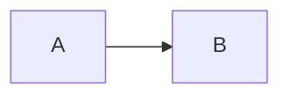

# Semantic fidelity study

See [[Lab Notes|Lab notes]] and [@smith2024].

| Stage | Value |
| :--- | ---: |
| Research | 42 |

- [x] Reviewed
- [/] In progress
- [>] Forwarded

A footnote[^method].

[^method]: Reproducible source.

Equation $x^2 + 1$.

$$
a^2 + b^2
$$

<em>Safe emphasis</em>

